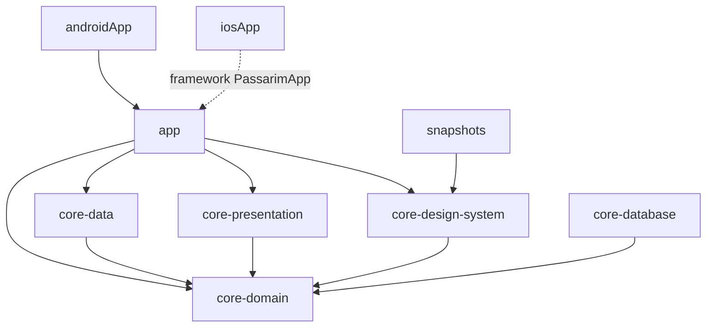

# Passarim — app

Guia de aves do Brasil para Android e iOS, em **Kotlin Multiplatform** com **Compose Multiplatform**: todo o código de produto fica em `commonMain`; Android e iOS só têm uma casca fina. O app fala com o BFF do [`passarim-bff`](https://github.com/velosobr/passarim-bff), que roda localmente no `docker compose` do [`passarim-docs`](https://github.com/velosobr/passarim-docs).

> Estado: **etapa 5a (fundação)**. O app abre com splash e as abas Explorar · Favoritos · Configurações (ainda vazias) e tem uma tela de depuração que prova a conexão com o BFF. As telas de produto chegam nas fatias 5b a 5e (specs em `passarim-docs/docs/superpowers/specs/`).

## Requisitos

| Ferramenta | Versão |
|---|---|
| JDK | **21** (o Paparazzi 2.x gera bytecode Java 21) |
| Android SDK | plataforma 37 (`compileSdk` 37) e um emulador ou aparelho |
| Xcode | 16+ com um simulador iOS (só para o iOS) |
| XcodeGen | `brew install xcodegen` (gera o projeto Xcode) |
| Docker | para o backend local (`passarim-docs`) |

Use o `./gradlew` do repositório (Gradle 9.8.1); não é preciso instalar o Gradle. Se o `java` do seu terminal não for o 21, exporte `JAVA_HOME` antes de rodar.

## Módulos



| Módulo | Papel |
|---|---|
| `androidApp` | Casca Android: `Application`, `Activity`, splash, ícone adaptativo, `BuildConfig` |
| `iosApp` | Casca iOS: projeto Xcode gerado por XcodeGen, Info.plist, ícone e Launch Screen |
| `app` | `App()`, navegação (abas), Koin, tela de depuração, ponto de entrada do iOS |
| `core:domain` | `Result`, `DataError`, `AppConfig`, modelos e interfaces de repositório |
| `core:data` | Ktor (`safeCall`), repositórios que falam com o BFF, `MediaUrlRewriter` |
| `core:presentation` | `UiText`, `ObserveAsEvents`, mensagens de erro |
| `core:design-system` | Tema (tokens, Manrope), componentes genéricos |
| `core:database` | Reservado para o Room (etapa 5d); alvo `jvm()` só para testes |
| `snapshots` | Testes de snapshot com Paparazzi (módulo Android puro) |
| `build-logic` | *Convention plugins* do Gradle |

Regras: `presentation → domain ← data`; features nunca dependem entre si; só o `app` conecta tudo. Componentes de feature (mapa, player) não entram no design system.

## Rodando contra o backend local

1. No `passarim-docs`: `cp .env.example .env` e `docker compose up -d` (o Traefik publica o BFF em `localhost:8080`).
2. Escolha o caso:

| Caso | Como |
|---|---|
| **Emulador Android** | `./gradlew :androidApp:installDebug` e abra o app. O endereço padrão é `http://10.0.2.2:8080` (o emulador enxerga o computador por esse IP) |
| **Simulador iOS** | `cd iosApp && xcodegen generate`, abra `iosApp.xcodeproj` no Xcode e rode. O endereço é `http://localhost:8080` (`iosApp/Config/Debug.xcconfig`) |
| **Aparelho físico** | O aparelho precisa alcançar o computador pela rede: no `passarim-docs`, suba com `docker compose -f docker-compose.yml -f docker-compose.device.yml up -d`. Android: crie `local.properties` com `bff.baseUrl=http://<IP-do-computador>:8080`. iOS: crie `iosApp/Config/Local.xcconfig` com `BFF_BASE_URL = http:/$()/<IP>:8080` |

O texto puro (HTTP) só é permitido no **debug** (network security config no Android, exceção de ATS no iOS). O release exige HTTPS e aponta para um endereço reservado e inválido até a etapa 6 (deploy).

**Prova da conexão:** em debug, a aba Configurações tem o botão "Depuração", que busca `GET /v1/filters` e mostra a contagem de biomas e estados. Com o backend parado, mostra "Sem conexão".

**Mídia:** o BFF monta URLs de mídia com `localhost`. No debug o `MediaUrlRewriter` troca só o host pelo do BFF (por exemplo `10.0.2.2`), mantendo a porta. O `compose` não muda.

No simulador iOS listado por `xcrun simctl list devices`, prefira `-destination 'platform=iOS Simulator,id=<UDID>'` ao nome do aparelho se o `xcodebuild` não achar o destino.

## Testes e qualidade

```bash
./gradlew allTests                      # lógica: commonTest no Android (JVM do host) e no simulador iOS
./gradlew ktlintCheck detekt            # estilo e análise estática (ktlintFormat corrige o que dá)
./gradlew :snapshots:verifyPaparazziDebug   # compara os snapshots com as referências
./gradlew :snapshots:recordPaparazziDebug   # regrava as referências (revise o diff antes de commitar)
./gradlew :androidApp:assembleDebug :app:linkDebugFrameworkIosSimulatorArm64
scripts/osv-gate.sh                     # vulnerabilidades altas/críticas nas dependências do app
```

- A lógica usa `kotlin.test` + Turbine + AssertK em `commonTest`. Só os snapshots usam JUnit4 (a regra do Paparazzi).
- Os snapshots cobrem claro e escuro × fonte 1.0×, 1.3× e 2.0×. O Paparazzi usado é a **2.0.0-alpha05** (a 1.3.5 estável não funciona com o AGP 9 nem com o Gradle atual); o fallback é o Roborazzi.
- Depois de mudar dependências: `./gradlew resolveAndLockShipped --write-locks` e commite os `gradle.lockfile`. O CI confere se as travas estão em dia.

## Design

Cores, tipografia e formas vêm de `passarim-docs/docs/design/tokens/passarim-tokens.json`. **Mudanças de cor começam lá** (com a verificação de contraste) e depois são refletidas em `core/design-system/.../theme/Color.kt`. A fonte é a Manrope (variável). Os ícones vêm de `design/icon/` (cópia dos SVGs do `passarim-docs`); `scripts/render-ios-icons.sh` gera os PNGs do iOS (requer o Chrome).

## Segurança

HTTPS apenas fora do debug · nenhum segredo no app · R8 no release (regras de keep na 5e) · sem coleta de dados pessoais · sem *certificate pinning* no MVP (ADR-0008) · dependências verificadas no CI (`osv-scanner`, Dependabot, gitleaks).

## Convenções

Commits no formato `<tipo>: mensagem` em português, direto na `main`. Código comentado em português, para estudante; identificadores em inglês. Cada decisão técnica relevante vira um ADR no `passarim-docs`.
